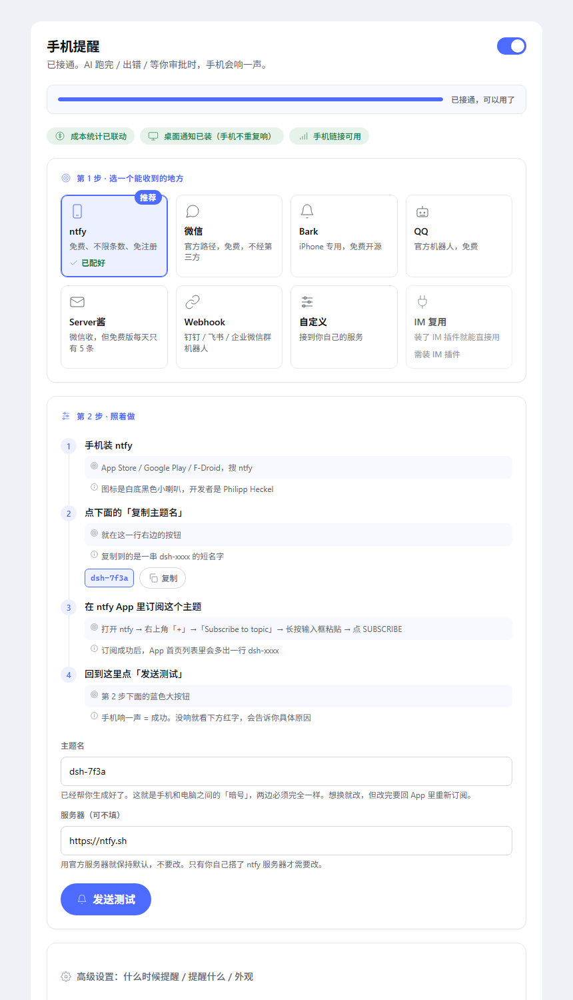

# dsh-alert · 手机提醒

[](https://github.com/ysl289/dsh-alert/actions/workflows/test.yml)
[](LICENSE)
[](package.json)

> AI 在电脑上干活，人在外面刷手机。跑完了、出错了、等你审批了 —— 手机上响一声。

一个**独立**的 DeepSeek Harness 插件：不**要求**任何其它插件，只订阅宿主自己的会话事件。

装了 dsh-im / cost-meter / pocket 之类的插件会**自动增强**（见[联动](#和你已装的插件联动)），
没装也完全能用 —— 每一条联动都是可选的，缺了就安静地不生效。



## 它解决什么

用 AI 跑长任务时，最难受的是这三件事：

1. **不敢走开** —— 怕它跑完了没人知道
2. **走开了又怕错过审批** —— 它卡在那儿等你点一下，一等就是半小时
3. **一有动静就响** —— 通知太多，最后全被静音，等于没有

这个插件的核心不是「能推送」，而是**知道什么时候不该吵你**。

## 什么时候会提醒你

| 场景 | 默认 | 说明 |
|---|---|---|
| ✅ 任务完成 | 提醒 | 这一轮真的干完了 |
| ❌ 任务出错 / 输出超限 | 提醒 | 高优先级，必发 |
| ✋ 等你审批 | 提醒 | 有工具调用等你点「批准」 |
| ❓ 等你回答 | 提醒 | agent 用 `ask_user_question` 问你 |
| ⛔ 任务受阻 | 提醒 | 目标被阻塞 |
| 🎯 目标完成/受阻 | 提醒 | goal 终态 |
| ⏹️ 你自己按了停止 | **不提醒** | 你就在电脑前，不用吵 |
| 🔀 fork 出来的会话 | **不提醒** | 那不是一次真正的完成 |
| 🤖 子代理会话 | **默认不提醒** | 否则一个团队任务会响几十次 |

每一条都能单独开关。

## 什么时候**不**吵你（四道闸门）

这是「提醒时间自己选」的全部内容：

| 闸门 | 配置 | 作用 |
|---|---|---|
| **延迟提醒** | `delaySeconds`，默认 20 秒 | 等 N 秒再发。**这期间你回到电脑操作了，提醒自动取消** |
| **短任务过滤** | `minTurnDurationSeconds`，默认 30 秒 | 跑得比这快的不值得吵 |
| **免打扰时段** | `quietHours`，如 `23:00-08:00` | 这个时段怎么处理由 `quietMode` 决定 |
| **定时汇总** | `digestEnabled` + `digestMinutes` | 不逐条发，攒一段时间合成一条 |

免打扰时段有三种处理方式：

- `digest`（默认）：攒着，时段过了发一条汇总
- `drop`：直接丢弃，早上起来也不看
- `send`：照发，只是标个记号

## 能推到哪儿（7 个免费通道，可多选）

| 通道 | 收到的地方 | 免费额度 | 门槛 |
|---|---|---|---|
| **ntfy** | 手机 App 锁屏 | **不限条数**（开源） | 装 App、订主题，免注册 |
| **企业微信自建应用** | **个人微信** | 账号上限×200 人次/天 | 注册企业微信，官方路径 |
| **Bark** | iPhone 锁屏 | 免费开源 | 装 App 拿 key |
| **QQ 官方机器人** | QQ 消息 | 20 条/分、1000 条/天 | QQ开放平台个人认证 |
| **Webhook** | 钉钉 / 飞书 / 企微群机器人 | 各平台自有额度 | 群加机器人拿地址 |
| **Server酱** | 微信 | ⚠️ **每天只有 5 条** | 微信扫码拿 SendKey |
| **自定义 HTTP** | 任意 | 看你自己的服务 | 自己写 URL / 方法 / 头 / 体 |

**可以同时开多个**，比如「企业微信必达 + ntfy 做锁屏直达」。只要有一条送达就算成功，不会因为某个通道挂了就整体失败。

### 已经拿掉的两个

- **PushPlus** —— [免费额度各渠道都是 0](https://www.pushplus.plus/doc/guide/use.html)，必须付费，已移除
- **抖音** —— [私信能力只对企业主体开放](https://developer.open-douyin.com/docs/resource/zh-CN/dop/ability/interaction-management/im)，且是给商家发粉丝的，不是给自己发通知，做不了

### 已经有 IM 插件的人：可以直接复用

如果你装了 [@xmanrui/dsh-im](https://www.npmjs.com/package/@xmanrui/dsh-im)，插件列表里会多一个 **「IM 复用」** 通道：

- 它直接调 dsh-im 的 `ctx.dshIm.send()`，**不用再配一遍**
- 从已有的机器人 + 投递目标里选，两步搞定
- **没装的人也能看到这条**，界面会告诉你怎么装、装完会自动变成选择框

## 关于隐私

- 提醒内容默认带一段 AI 最后的回复摘要（`includeExcerpt`，可关）
- **工作目录默认不带**（`includeCwd`，因为目录名可能暴露项目名）
- 走第三方通道（Server酱 / ntfy 公共主题）时，消息会经过它们的服务器。介意的话用**企业微信自建应用**或**自建 ntfy**
- 凭据存在 `~/.dsh/dsh-alert/settings.json`，文件权限 0600

## 设置页：两步接通

重启 DSH 后进 **设置 → 手机提醒**，界面是**向导式**的，不是一堆表单：

```
① 选一个能收到的地方     [ntfy 推荐] [微信 官方] [Bark] [QQ] [Server酱]
                        [Webhook] [自定义] [IM 复用]
                        （按免费 + 省事排序，已配好的打 ✓ 已配好）
────────────────────────────────────────────
📊 进度  ████████████████████  已接通，可以用了
🏷️  💰 成本统计已联动   📲 手机链接可用   🎨 跟随 Claude 皮肤
────────────────────────────────────────────
② 照这几步做             1. 手机装 ntfy
                        2. App 里点 + → 粘贴主题名 → 订阅    [复制]
                        3. 回到这里点发送测试
                        [ 主题名（自动生成） ]
                        [ 发送测试 ]  ← 同时就是"验证"
高级（折叠）             什么时候提醒 / 延迟 / 免打扰 / 其他通道 / 面板外观
```

**省事程度排序**（这就是"小懒虫"路线）：

| 顺位 | 通道 | 你要做的 | 装 App |
|---|---|---|---|
| 1 | **ntfy** | 装 App → 粘贴自动生成的主题名 | 是 |
| 2 | **微信（企业微信官方）** | 注册企业微信 → 建应用 → 扫码关注 | 否 |
| 3 | Bark | 装 App → 复制 key | 是 |
| 4 | QQ 官方机器人 | 开放平台认证 → 建机器人 → 拿 openid | 否 |
| 5 | Server酱 | 微信扫码 → 复制 SendKey | 否 |
| 6 | Webhook / 自定义 | 粘一个地址 | 否 |

### 零输入设计

- **ntfy 主题名自动生成**：首次运行就生成好 `dsh-a1b2c3d4` 并落盘，面板上直接给「复制」按钮，不用自己想名字
- **每步都带跳转**：「去注册」「去 App Store」直接点开，不用自己去搜
- **发送测试 = 验证**：点一次就同时完成「保存 + 发送 + 报告结果」，失败会告诉你具体原因（Key 无效 / 用户关了主动消息 / 超频控）
- **已配好的通道打 ✓**：卡片上标「已配好」，不用记自己配到哪了
- **高级设置默认折叠**：不挡路，想调再展开

配置即时生效，不用重启。设置存在 `~/.dsh/dsh-alert/settings.json`（权限 0600）。

> 面板是独立实现的，不走 DSH 的「自动生成表单」——那套机制目前没有客户端渲染实现。

### 数据通道

浏览器端 `ctx.connection.rpc.call('/dsh-alert', endpoint, payload)` → Host 的 `POST /dsh-alert/<endpoint>`。

- 请求：`{ type: 'client-request', rpcId, method: endpoint, payload }`
- 响应：`{ type: 'server-response', rpcId, result }`
- 信封：成功 `{ ok: true, value }`，失败 `{ ok: false, error: { code, message, details } }`
- 端点：
  - `status` → `{ settings, channels, ready, im, integrations, theme }`
    （ready = 真的能收消息的通道；im = IM 通道可用性；
    integrations = 联动探测结果；theme = 服务端解析好的主题色卡）
  - `save` → `{ settings, ready }`
  - `test` → `{ ok, results }`，可带 `{ channel }` 只测某一个

传输层用 `ctx.inject(['webServer', 'connection'], ...)` **运行时注入**，而不是静态 `inject`：
静态声明会让插件在没这些服务的 profile（比如 headless）里根本不加载，连推送都没了。
服务不存在时只是没有设置页，推送功能照常。

信任栅栏复用宿主 Connection 的 `requestRejection(req)`（Host/Origin/cookie 校验）；
没有 Connection 服务时退回最小 loopback 校验。

### 三个踩过的坑（别再踩）

**1. 不要导出普通对象当 `Config`。** 宿主的 `resolveConfig` 会做：

```js
if (!runtime.Config) return config;
runtime.Config['~standard'].validate(config)
```

`schemastery` / `zod` 实例才有 `~standard`。导出一个普通对象会让这行抛 TypeError，
**插件在激活阶段就失败**，然后被插件管理器写成 `disabled: true` ——
现象是"设置页读不到路由"，而根因在加载期，很难反推。本插件不声明 `Config`。

**2. RPC 信封字段是 `value` 不是 `data`。**
`ctx.connection.rpc.call()` 返回 `{ ok, value }`。

**3. Cordis 的 ctx 是 Proxy：访问没 inject 的服务会抛异常，不是返回 undefined。**

这意味着「检测某个插件装没装」这件事本身也会炸：

```js
// ❌ 会抛 cannot get required service costMeter
if (ctx.costMeter) { ... }

// ✅ 必须包起来
function safeGet(ctx, key) {
  try { return ctx?.[key]; } catch { return undefined; }
}
```

`lib/integrations.js` 和 `lib/im-bridge.js` 里每一处读别人的服务都走 `safeGet`。
测试用真 Proxy 模拟（`test/integrations.test.mjs`），普通对象测不出这个坑。

验证方法：用真实 Cordis 加载一遍（`test/cordis-live.test.mjs`），
比对着文档猜可靠得多。

## 美术风格：两套皮肤，跟随你的宿主

面板有两套色卡，布局和交互完全一样，只有颜色、圆角、字重不同：

| 皮肤 | 强调色 | 用在哪儿 |
|---|---|---|
| **Claude** | 珊瑚 `#d97757` + 米白 | 本地版；装了 `dsh-claude-style` 时自动跟随 |
| **DeepSeek** | 品牌蓝 `#4d6bfe` + 中性灰 | 上传版默认 |

设置里「面板外观」有三档：**跟随宿主 / DeepSeek 蓝 / Claude 珊瑚**。
选「跟随宿主」时，装了换肤插件就用 Claude 色卡，没装就用 DeepSeek —— 你的面板不会成为界面上唯一的异类。

色卡定义在 [`lib/theme.js`](lib/theme.js)，是纯数据表；客户端 [`client/client.js`](client/client.js) 里有一份同源副本（浏览器端不能 import 服务端模块）。
深色变体只覆盖颜色、**不动圆角与字重** —— 否则切换深色模式布局会跳一下。

### 设计规范（都有测试锁着）

这套界面按 `ui-ux-pro-max` 的规则做的，`test/design-system.test.mjs` 里 27 条断言防止改回去：

| 规则 | 做法 | 为什么 |
|---|---|---|
| **不用 emoji 当图标** | 24 个内联 SVG，统一 24×24 viewBox、1.5 描边、outline | emoji 是字体，跨平台形状/颜色不一致，且无法跟随主题色 |
| **字号走音阶** | 12 / 14 / 16 / 20 / 26，只取 token | 之前 11.5 / 12.5 / 13.5 混用，单看还行，整体没节奏 |
| **间距 4 的倍数** | `SPACE` token：4 / 8 / 12 / 16 / 20 / 24 / 32 / 40 | 之前 5 / 9 / 11 / 13 随手写 |
| **触控目标 ≥44px** | 按钮 44–48，输入框 minHeight 44 | 手指点击的下限 |
| **对比度 ≥4.5:1** | 弱化文字从 `#9a938d`(3.0:1) 提到 `#78716b`(4.8:1) | 原来的灰字几乎看不见 |
| **每个控件有焦点环** | 2px 实线 + 2px offset，跟随强调色 | 键盘用户必须看得见自己在哪 |
| **尊重 reduced-motion** | 检测到偏好后所有 transition 归零 | 前庭功能障碍用户会因动画不适 |

主按钮文字色也按对比度选过：珊瑚底上放白字只有 2.9:1，所以 Claude 皮肤用近黑 `#1f1e1d`（5.3:1）；DeepSeek 蓝底放白字有 5.97:1。

### 两套色卡的取色依据

- **不用纯黑**：深色模式画布是 `#191919` / `#13161d`，不是 `#000000`
- **强调色克制**：软背景透明度都在 0.3 以下，强调色占可见元素不超过一成

## 和你已装的插件联动

全部可选：没装对应插件时那一条自动不生效，不报错、不提示、不影响推送。

| 联动对象 | 效果 | 怎么判断装没装 |
|---|---|---|
| **dsh-cost-meter** | 提醒里带上「本轮花费 ¥0.32」 | 服务 `costMeter` 存在 |
| **dsh-pocket** | **通知里的链接换成手机能打开的地址** | loader 里有 `dsh-pocket` |
| **dsh-claude-style** | 面板自动用 Claude 珊瑚色卡 | loader 里有该 entry |
| **dsh-notify-windows** | 你在电脑前已收到桌面通知，手机不再重复响 | loader 里有该 entry |
| **@xmanrui/dsh-im** | 直接复用它的机器人往微信/飞书/Telegram 发 | 服务 `dshIm` 存在 |

### dsh-pocket 这条为什么最值钱

宿主给的 `session.host.webUrl` 是 `http://127.0.0.1:<port>` —— 那在手机上是**手机自己**，点了必然打不开。
装了 [dsh-pocket](https://github.com/shaobeichen/dsh-pocket) 后，插件会读它的设置文件，算出局域网地址（例如 `http://10.169.96.251:3081`），
把提醒里的链接换成这个，手机连同一个 WiFi 就能直接点开会话。

设置页会明确告诉你当前状态：**手机上点得开** / **pocket 装了但局域网没开** / **手机上点不开（链接是 127.0.0.1）**，并把可用地址显示出来供复制。

> 读取时机是**每次真要发提醒时**，不是启动时缓存 —— 你可能在我们加载之后才去 pocket 里打开局域网开关。

## 装法

### 方式一：从 GitHub 装（推荐）

```powershell
cd "$env:USERPROFILE\.dsh\profiles\desktop"

# 把 <你的用户名> 换成实际仓库地址
node "$env:USERPROFILE\.dsh\dsh-runtimes\dsh-primary-runtime\dependencies\pnpm\bin\pnpm.cjs" `
  add "github:<你的GitHub用户名>/dsh-alert"
```

### 方式二：从本地目录装（改代码调试用）

```powershell
cd "$env:USERPROFILE\.dsh\profiles\desktop"
node "$env:USERPROFILE\.dsh\dsh-runtimes\dsh-primary-runtime\dependencies\pnpm\bin\pnpm.cjs" `
  add "link:<你克隆到的路径>/dsh-alert"
```

### 两种方式都要做的最后一步

把 `dsh-alert` 加进 profile `package.json` 的 `dsh.profile.bundles` 数组：

```json
{
  "dsh": {
    "profile": {
      "bundles": ["...", "dsh-alert"]
    }
  }
}
```

然后**重启 DSH**。验证：设置里出现「手机提醒」。

> 为什么需要手动加 `bundles`：这是 DSH 的 bundle 机制要求，插件自己改不了宿主的 profile。

## 本地验证

```bash
npm test
```

会跑 339 项离线断言。其中「真实 Cordis」那两项需要宿主自带的 Cordis 副本
（它打包在 `app.asar` 里，不能随仓库分发），没配就自动跳过：

```powershell
# 从 app.asar 里抽出 Cordis（只需要做一次）
# 抽出后把路径告诉测试
$env:CORDIS_ENTRY="C:\path\to\cordis\lib\index.js"
npm test
```

## 配好第一个通道（以 ntfy 为例，2 分钟）

1. 手机装 **ntfy** App（App Store / Google Play / F-Droid）
2. App 里 `+` → 填一个随机主题名，例如 `dsh-7f3a91c2` → 订阅
3. 插件设置里通道选 `ntfy`，主题名填 `dsh-7f3a91c2`
4. 点「发送测试」，手机响了就配好了

> ⚠️ ntfy.sh 的公共主题**谁猜到名字谁就能订阅**，一定要用随机串，别用 `dsh`、`test`。

## 配企业微信（想直接在微信里收）

1. [注册企业微信](https://work.weixin.qq.com/)（个人可注册，免费版上限 200 人）
2. 管理后台 → 应用管理 → **创建自建应用**，记下 `AgentId`
3. 我的企业 → 企业信息，记下 **CorpID**；自建应用里点「查看 Secret」拿到 **Secret**
4. **我的企业 → 微信插件 → 扫码关注**（关键一步，不关注收不到）
5. 插件里填 CorpID / Secret / AgentId，收件人填 `@all` 或你的成员账号

## 配 QQ 机器人

1. [QQ开放平台](https://q.qq.com) → 注册 → **个人认证**（可建 5 个机器人）
2. 创建机器人，拿 **AppID / AppSecret**
3. 在「开发设置」里把**你自己**加为「开发体验用户」
4. 先给机器人发一条消息，从回调里拿到你的 **openid**

> ⚠️ 配额：单聊主动消息 20 条/分钟、1000 条/天，够用。
> ⚠️ 如果你在 QQ 客户端里关掉「允许机器人主动发消息」，会返回 `40034105` 发不出去。

## 设置项

| 配置 | 默认 | 说明 |
|---|---|---|
| `enabled` | true | 总开关 |
| `delaySeconds` | 20 | 延迟多少秒再发；这期间你回来操作了就取消 |
| `minTurnDurationSeconds` | 30 | 跑得比这快不提醒 |
| `quietHours` | 空 | 免打扰时段，如 `23:00-08:00` |
| `quietMode` | digest | 免打扰时段怎么办 |
| `digestEnabled` | false | 开启定时汇总 |
| `digestMinutes` | 30 | 汇总窗口 |
| `includeExcerpt` | true | 带上 AI 最后一段回复 |
| `excerptMaxChars` | 160 | 摘要字数上限 |
| `includeCwd` | false | 带上工作目录 |
| `includeSubagents` | false | 子代理会话也提醒 |
| `openOnClick` | true | 通知里带跳回会话的链接 |
| `includeCost` | false | 装了 dsh-cost-meter 时带上本轮花费 |
| `theme` | auto | 面板外观：`auto` 跟随宿主 / `claude` / `deepseek` |
| `timeoutMs` | 10000 | 单次请求超时 |
| `retries` | 2 | 失败重试次数 |

## 自测

```bash
npm test              # 339 项离线断言
node test/smoke.mjs   # 起假服务器跑通整条链路
```

测试覆盖：策略判断（26）、渲染文案（18）、通道请求构建与业务码（33）、发送重试与超时（15）、端到端（4）、插件集成（17）、RPC 传输（20）、契约（5）、宿主契约（9）、客户端（11）、面板渲染（26）、快速开始（13）、IM 通道（19）、主题（17）、联动（34）、设计系统（27）、真实 Cordis（2）。

## 设计约束（刻意的）

- **纯提醒**：手机上看不到操作按钮。点了通知只是跳回电脑上的那个会话。想远程点批准，那是另一类插件（dsh-im 之类）的事。
- **不强依赖其它插件**：只读 DSH 宿主自己的事件与设置接口。联动全是可选的。
- **绝不干扰会话**：发送失败、通道异常、配置错误，全部只写日志，绝不冒泡到 agent 循环。

## 目录结构

```
lib/
  index.js          插件入口：订阅事件、串起各层、暴露 RPC
  policy.js         策略：触发判断、延迟取消、免打扰、汇总
  render.js         渲染：事件 → 手机上一段话
  deliver.js        发送：分发、重试、去重
  settings.js       设置：默认值、持久化、schema
  theme.js          两套美术风格色卡（Claude 珊瑚 / DeepSeek 蓝）+ 深色变体
  integrations.js   联动探测：cost-meter / pocket / claude-style / notify-windows
  http.js           HTTP 小工具
  channels/         7 个 HTTP 通道，每个一个文件；加通道只写这一个文件
  im-bridge.js      IM 通道（可选，复用已装的 @xmanrui/dsh-im）
client/
  client.js         浏览器端设置面板（__ModuleLoader__ 格式，独立打包，含两套皮肤）
test/               339 项断言 + 端到端 + 冒烟 + 真机单发 + 真实 Cordis
```

## 许可

MIT
